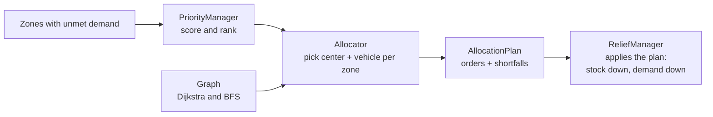

# Disaster Relief Resource Allocation and Routing System

A C++17 simulation of disaster-relief logistics. Given a set of affected zones, supply centers, delivery vehicles and a road network, it ranks the zones by urgency, finds the cheapest road route from a supply center to each zone, decides who delivers how much, and repeats step by step while roads close and reopen.

Everything is deterministic: the same input always produces the same plan, including how ties are broken.

## How one simulation step works



1. **Rank.** Only zones that still have unmet demand take part. Each gets a priority score (below) and goes into a max-heap.
2. **Route and allocate.** Zones are taken from the heap, most urgent first. For each zone the allocator repeatedly:
   - picks the **cheapest reachable center** that still has stock (equal cost: lowest center id),
   - picks the **largest-capacity available vehicle** that can reach that center (equal capacity: lowest vehicle id),
   - books `min(demand left, stock left, vehicle capacity)` units,
   - until the zone is covered or something runs out. Whatever could not be served is recorded as a **shortfall** with a reason.
3. **Apply.** `ReliefManager` removes the stock from the centers and the delivered units from each zone's demand.

The allocator only *plans*. It works on copies of stock and vehicle availability, so the real objects change only when the plan is applied.

Each vehicle makes at most **one delivery per step**, so a zone needing 500 units served by a 100-capacity vehicle takes several steps.

## Priority score

```
score = w_severity   * (severity / 5)
      + w_population * (affectedPopulation / maxAffectedPopulation)
      + w_demand     * (unmetDemand / maxUnmetDemand)
```

- Default weights: **0.50 severity, 0.25 population, 0.25 demand**. They must be non-negative and sum to 1, otherwise `PriorityManager` throws `std::invalid_argument`.
- Population and demand are normalised against the maximum among the zones in the current step, so scores shift as demand is delivered.
- Severity is an integer from 1 (low) to 5 (critical).
- Equal scores: the smaller zone id ranks first.
- The weights are starter defaults, **not validated disaster-response policy**.

## Build and run

Requires CMake 3.20+ and a C++17 compiler. Checked with GCC 13.3 and CMake 3.28 on Linux.

```bash
cmake -S . -B build
cmake --build build
./build/disaster_relief
```

With multi-config generators (Visual Studio, Xcode) the executable lands in a configuration subfolder, for example `build/Debug/disaster_relief.exe`.

### Interactive console

```bash
./build/disaster_relief --interactive          # type commands
./build/disaster_relief --script demo.txt      # replay a command file
```

Type `help` for the command list. Names use underscores for spaces. Zone, center and junction ids share one number space, so they must not overlap (suggested: zones 1-99, centers 101-199, junctions 201 and up). `demo` loads the three-zone map.

### Tests

```bash
ctest --test-dir build --output-on-failure
```

| Test executable | Covers |
|---|---|
| `priority_manager_tests` | scoring, ranking, the zone heap |
| `graph_tests` | roads, blocking, shortest path, reachability |
| `allocator_tests` | center / vehicle selection, shortfalls |
| `relief_manager_tests` | registering and looking up zones, centers, vehicles, resources |

The tests use plain `assert`, which the compiler removes when `NDEBUG` is defined. **Run them in a Debug or default build, not `-DCMAKE_BUILD_TYPE=Release`**, or they will pass without checking anything.

## Using the library

This is the setup `main.cpp` runs: three zones, one warehouse, one truck, and a road that closes for two steps.

```cpp
#include "ReliefManager.h"
#include "Simulation.h"

ReliefManager relief;
relief.addZone({1, "North Sector", 5, 1200, 500});   // id, name, severity, population, unmet demand
relief.addZone({2, "River District", 4, 2000, 300});
relief.addZone({3, "East Village", 3, 800, 700});

ResourceCenter depot(101, "Central Warehouse");
depot.addStock(DEFAULT_SUPPLY_ID, 400);
relief.addCenter(depot);
relief.addVehicle(Vehicle(1, 100, 101));             // id, capacity, start node

relief.addLocation(3);                               // zone 3 exists but has no roads
relief.addRoad(101, 201, 4);                         // roads are two-way
relief.addRoad(201, 1, 6);
relief.addRoad(201, 2, 3);

Simulation sim(relief);
sim.schedule(2, "Road 201-1 is blocked", [](ReliefManager& r) {
    r.setRoadBlocked(201, 1, true);
});
sim.schedule(4, "Road 201-1 reopens", [](ReliefManager& r) {
    r.setRoadBlocked(201, 1, false);
});
sim.run(10);                                         // at most 10 steps
```

`Simulation::schedule(step, description, action)` runs `action` just before the given step (counting from 1). `run` stops when all demand is met, when the step limit is hit, or when a step dispatches nothing and no later event is pending.

### Ids and the road graph

- A zone's `id` and a center's `id` are used directly as **graph node ids**. They must therefore be unique across zones and centers, and must not clash with junction ids. Junctions are simply node ids that appear in roads but are neither a zone nor a center (like `201` above).
- A vehicle's start node must be a node that exists in the graph, otherwise it can never be dispatched.
- Roads are undirected. A negative or non-finite cost is silently ignored.
- The `nodeId` field on `DisasterZone` and the `node()` accessor on `ResourceCenter` are not used by the simulation yet.

## Example output

Trimmed from a real run (`main.cpp` prints with `std::fixed` and 3 decimals, hence `10.000`). Step 1 of 5:

```
=== Step 1 ===
[1] Priority ranking:
    1. North Sector (score 0.829)
    2. River District (score 0.757)
    3. East Village (score 0.650)
[2] Reachability and Nearest-center route:
    North Sector <- Central Warehouse
        Route: Central Warehouse (101) -> Junction 201 -> North Sector (1)
        Cost: 10.000
    River District <- Central Warehouse
        Route: Central Warehouse (101) -> Junction 201 -> River District (2)
        Cost: 7.000
    East Village: UNREACHABLE
[3] Allocation Plan
    Central Warehouse -> North Sector: 100 units by vehicle 1 (route cost 10.000)
    ...
    Shortfall: East Village still needs 700 units (no center with supply can reach this zone)
[4] Dispatch and state update:
    Vehicle 1 delivered 100 units to North Sector
```

The full run closes the road 201-1 before step 2 (North Sector becomes unreachable, River District is served instead), reopens it before step 4, and ends with:

```
--- Simulation finished after 5 step(s) ---
Stopped early; some demand could not be served.
Stock left: 0 | total unmet demand: 1100
```

The warehouse's 400 units run out and East Village never had a road, so the simulation ends with unmet demand rather than looping.

## Project layout

```
include/             headers
  DisasterZone.h       zone data and validation
  PriorityManager.h    weights, scoring, ZoneQueue (max-heap)
  Graph.h              road network: Dijkstra, BFS reachability, blocking
  Allocator.h          Allocator::plan, AllocationPlan, Shortfall
  ReliefManager.h      owns all objects, runs one step
  Simulation.h         multi-step loop with scheduled events
  ResourceCenter.h     supply center and its stock
  Vehicle.h            vehicle with capacity and location
  Resource.h           supply type (name, unit)
  Types.h              Route, DispatchOrder, DEFAULT_SUPPLY_ID
  ScenarioBuilder.h    ready-made test worlds (see limitations)
src/                 implementations and main.cpp (the demo above)
tests/               assert-based test programs, one per module
CMakeLists.txt
```

## Known limitations

- **One supply type.** Allocation always uses `DEFAULT_SUPPLY_ID` (101). A zone has a single `unmetDemand` number, and the `Resource` registry is not used by the planning pipeline yet.
- **Vehicles do not move.** A vehicle is reused from its original node at the start of every step, and there is no travel time. `Vehicle::moveTo` and `setAvailable` exist but the simulation never calls them.
- **`ScenarioBuilder` is not wired in.** It is not part of any CMake target and has no tests. Its scenarios have no roads, start vehicles at node 0 (not a graph node), and reuse id 1 for both a center and a zone, so they would not dispatch anything through `ReliefManager::runStep` as written.
- **Shared id space** between zones, centers and graph nodes (see above).
- **No tests for `Simulation`.**
- Parallel roads between the same two nodes are blocked and unblocked together.

## Roadmap

- Use `nodeId` / `node()` to separate entity ids from graph node ids.
- Move vehicles and track their availability across steps.
- Per-resource demand and stock.
- Add `ScenarioBuilder` and `Simulation` to CMake with tests.
